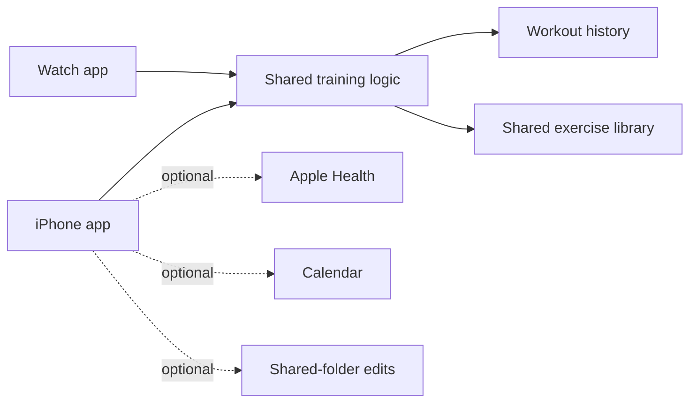

# Architecture

The phone and watch share training logic while presenting workout controls suited to each device. The app keeps workout history separate from the shared exercise library and supports optional integrations.

This diagram is a simplified view of the full private application; it is not a runnable implementation.
